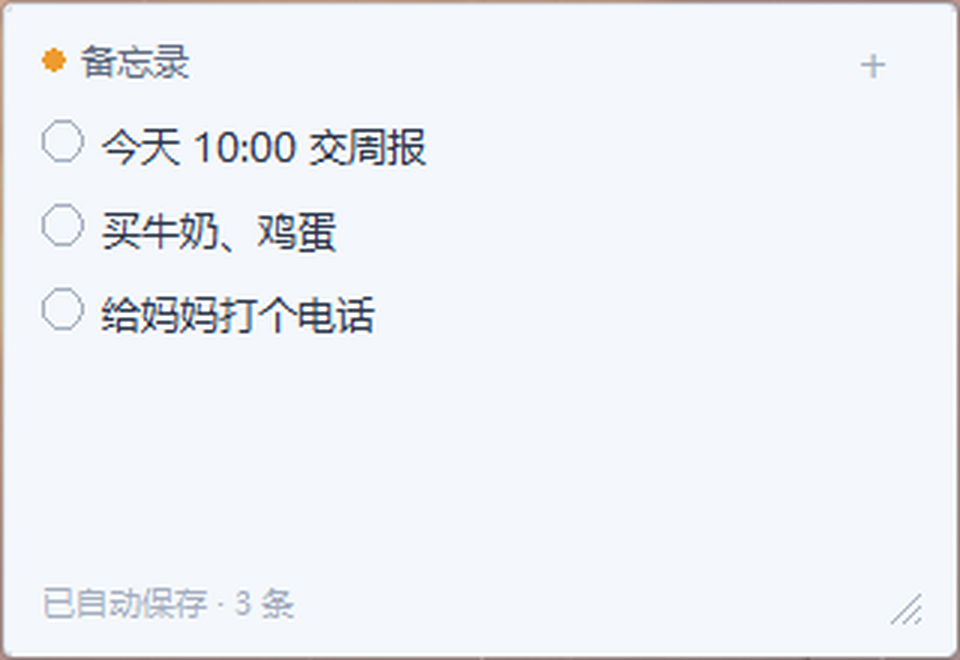

# 桌面备忘录

常驻桌面、可拖动的极简便签。**零第三方依赖**，只用 Python 标准库（Tkinter / ctypes / sqlite3）。




## 特性

- **小圆角无边框卡片**：没有标题栏、系统边框、关闭按钮，圆角半径 7px
- **微软雅黑 UI 字体**：Windows 8+ 自带的界面版雅黑，比普通雅黑更适合小字号 UI
- **按住任意位置拖动**：松手即保存坐标，下次开机原位出现
- **只活在桌面层**：不占任务栏、不进 Alt+Tab；`Win+D` 之后卡片仍在
- **托盘常驻**：关掉窗口不退出，单击托盘图标显示/隐藏
- **开机自启**：托盘右键菜单里一键开关
- **自动保存**：每改一次立即写盘，强杀进程也不丢
- **右下角拖拽缩放手柄**：可自由调整卡片大小
- **本地 API + MCP**：Hermes Agent 等外部程序可以远程增删事项、开关程序与自启
  （见 [docs/api.md](docs/api.md)）

## 运行

```bash
# 直接用（无需安装）
python run.pyw

# 或用模块方式
set PYTHONPATH=src
python -m desktop_memo

# 装成命令
pip install -e .
desktop-memo
```

`run.pyw` 用的是 `pythonw.exe` 语义，双击不弹黑框。

## 操作

| 操作 | 效果 |
|---|---|
| 按住卡片任意位置拖动 | 移动位置，松手自动记住 |
| 单击条目文字 | 进入编辑，回车保存，Esc 取消 |
| 单击圆圈 | 标记完成 / 取消 |
| 点右上角 `+` | 新增一条并直接进入编辑 |
| 右键条目 | 编辑 / 删除 |
| 拖右下角手柄 | 调整卡片大小 |
| 单击托盘图标 | 显示 / 隐藏卡片 |
| 右键托盘图标 | 开机自启开关、显示隐藏、退出 |

编辑时把内容清空再回车，等于删除该条目。

## 数据位置

`%APPDATA%\desktop-memo\memo.db`（SQLite，WAL 模式）

备份、迁移、卸载都只需要处理这一个文件。

## 架构

```
src/desktop_memo/
├── app.py         组装层：Tk 主循环 + 托盘轮询 + API 线程桥接
├── widget.py      表现层 + 交互层：纯 Canvas 自绘的卡片
├── win_layer.py   Win32 绑定：DWM 圆角、工具窗口、DPI、单实例、开机自启
├── tray.py        托盘图标：ctypes + Shell_NotifyIcon，独立线程
├── api.py         本地 HTTP API（标准库 http.server，token 鉴权）
├── mcp_server.py  MCP stdio 服务端（手写 JSON-RPC，零依赖）
├── store.py       存储层：SQLite 读写 + 窗口位置记忆
├── config.py      路径、常量、API token
├── cli.py         命令行入口
└── assets/        托盘图标
```

设计细节见 [docs/README.md](docs/README.md) 与 [docs/api.md](docs/api.md)。

## 为什么没有做"透出壁纸的云母"

试过，但代价太大，最后放弃了。完整结论：

想在 Tk 上透出 Windows 的云母/亚克力，必须同时满足：

1. `DwmExtendFrameIntoClientArea(-1,-1,-1,-1)` 把客户区交给 DWM 绘制
2. `DwmSetWindowAttribute(SYSTEMBACKDROP_TYPE)` 铺背景材质
3. Tk 底板用 `-transparentcolor` 色键抠成透明

**第 3 步会强制关闭文字的抗锯齿。** 实测数据：

| 状态 | 字形"中间灰度"占比 | 效果 |
|---|---|---|
| 不透明底板 | **55.2%** | 平滑 |
| 透明色键 | **0.9%** | 严重像素化、边缘锯齿 |

透明色键是逐像素精确匹配抠图，抗锯齿产生的半透明边缘像素无法被正确保留，
于是字形退化成硬边锯齿。在 Windows + Tk 上这是硬约束，换色键值、换文字颜色都救不回来
（测过 `#010101`、`#FF00FF`、`#00FF00`、`#0000FF`，全都一样）。

所以最终选择**保住文字清晰度**：不透明浅灰蓝底板，圆角和阴影交给 DWM。
想要真云母，得换 Qt / WPF / WinUI 这类能自己接管窗口合成的框架。

## 开发

```bash
pip install -e ".[dev]"
pytest
ruff check .
```

重新生成托盘图标：

```bash
python tools/make_icon.py
```

## 已知限制

- 仅支持 Windows（依赖 Win32 API）
- 托盘图标需要资源管理器外壳在运行（`Shell_TrayWnd`）