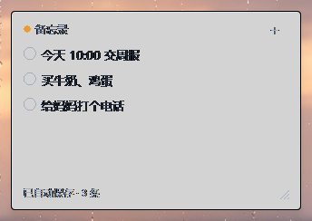
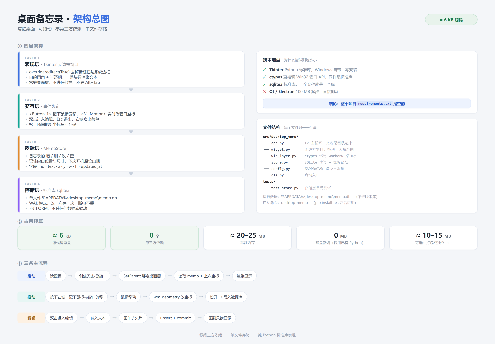

# 桌面备忘录

常驻桌面、可拖动的极简便签。**零第三方依赖**，只用 Python 标准库（Tkinter / ctypes / sqlite3）。





## 特性

- **云母玻璃背景**：通过 DWM 原生接口铺一层模糊壁纸质感的玻璃，跟随系统亮/暗色
- **微软雅黑 UI 字体**：Windows 8+ 自带的界面版雅黑，比普通雅黑更适合小字号 UI
- **小圆角无边框卡片**：没有标题栏、系统边框、关闭按钮，圆角半径 7px
- **按住任意位置拖动**：松手即保存坐标，下次开机原位出现
- **只活在桌面层**：不占任务栏、不进 Alt+Tab；`Win+D` 之后卡片仍在
- **托盘常驻**：关掉窗口不退出，单击托盘图标显示/隐藏
- **开机自启**：托盘右键菜单里一键开关
- **自动保存**：每改一次立即写盘，强杀进程也不丢
- **右下角拖拽缩放手柄**：可自由调整卡片大小

如果云母不可用（老系统、关闭合成、远程桌面），会自动退回不透明浅色底板，功能完全不变。
也可以用环境变量强制关闭云母：`set DESKTOP_MEMO_NO_MICA=1`。

## 运行

```bash
# 直接用（无需安装）
python run.pyw

# 或用模块方式
set PYTHONPATH=src
python -m desktop_memo

# 装成命令
pip install -e .
desktop-memo
```

`run.pyw` 用的是 `pythonw.exe` 语义，双击不弹黑框。

## 操作

| 操作 | 效果 |
|---|---|
| 按住卡片任意位置拖动 | 移动位置，松手自动记住 |
| 单击条目文字 | 进入编辑，回车保存，Esc 取消 |
| 单击圆圈 | 标记完成 / 取消 |
| 点右上角 `+` | 新增一条并直接进入编辑 |
| 右键条目 | 编辑 / 删除 |
| 拖右下角手柄 | 调整卡片大小 |
| 单击托盘图标 | 显示 / 隐藏卡片 |
| 右键托盘图标 | 开机自启开关、显示隐藏、退出 |

编辑时把内容清空再回车，等于删除该条目。

## 数据位置

`%APPDATA%\desktop-memo\memo.db`（SQLite，WAL 模式）

备份、迁移、卸载都只需要处理这一个文件。

## 架构

```
src/desktop_memo/
├── app.py         组装层：Tk 主循环 + 托盘事件轮询 + 生命周期
├── widget.py      表现层 + 交互层：纯 Canvas 自绘的云母卡片
├── win_layer.py   Win32 绑定：云母、工具窗口、DPI、单实例、开机自启
├── tray.py        托盘图标：ctypes + Shell_NotifyIcon，独立线程
├── store.py       存储层：SQLite 读写 + 窗口位置记忆
├── config.py      路径与常量
├── cli.py         命令行入口
└── assets/        托盘图标
```

设计细节见 [docs/README.md](docs/README.md)。

## 云母效果是怎么做出来的

这块踩了不少坑，结论记在 `win_layer.enable_mica()` 的注释里，简单说：

1. Tk 的 Frame / Label 是独立子窗口，会被 DWM 合成层挡在**后面**，
   所以整张卡片必须只用**一个 Canvas** 画所有东西。
2. `SetWindowCompositionAttribute`（网上最常见的亚克力写法）会整块盖住 Tk 绘制，
   实测文字全部消失 —— 不能用。
3. 可用组合是：`DwmExtendFrameIntoClientArea(-1,-1,-1,-1)`
   \+ `DwmSetWindowAttribute(SYSTEMBACKDROP_TYPE)`。
4. 客户区交给 DWM 后，Tk 底板要用**透明色键**抠掉，云母才露得出来。
   色键实测 `#010101` 彩边最少（138），洋红 `#FF00FE` 反而最脏（319）。
5. `DwmExtendFrameIntoClientArea` 会重置扩展样式，之后必须重新补
   `WS_EX_TOOLWINDOW`，否则卡片会跑回任务栏。

## 开发

```bash
pip install -e ".[dev]"
pytest
ruff check .
```

重新生成托盘图标：

```bash
python tools/make_icon.py
```

## 已知限制

- 仅支持 Windows（依赖 Win32 API）
- 托盘图标需要资源管理器外壳在运行（`Shell_TrayWnd`）